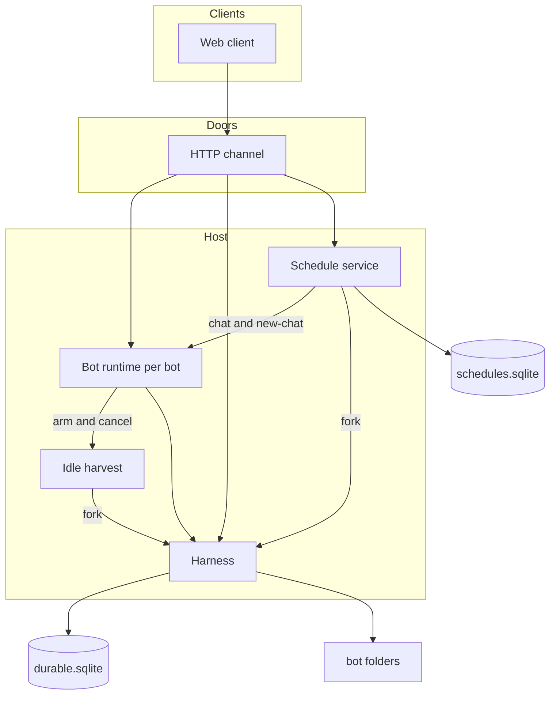

# Architecture

Several bots share one process and one durable session on `@earendil-works/pi-durable`. Channels talk to a bot runtime, and so do schedule fires that land in a chat. A schedule fire that forks a conversation, or an idle harvest task, talks to the harness directly. The runtime is the seam a later per-bot process would replace for doors and for chat fires. A user interface is a client of the same model: bots, chats, files, schedules, and a live transcript. The bundled web page is one such client.

This document is the index for the architecture documentation:

- [Bots, Chats & Storage](./architecture/bots-and-storage.md) — home directory layout, bot records, chat keys, session documents, and shared vs. per-chat state
- [Channels, Turn Lifecycle & Client API](./architecture/channels-and-turns.md) — inbound admission, turns, slash commands, and the HTTP/SSE client surface
- [Prompt, Knowledge, Memory & Idle Harvest](./architecture/knowledge-and-harvest.md) — prompt sections, `SOUL.md`, `MEMORY.md`, `knowledge/*.md`, compare-and-swap tools, and background harvest forks
- [Schedules, Extensions & Tool Policy](./architecture/schedules-and-tools.md) — sidecar schedule catalog, schedule tasks and targets, self tools, cross-bot tools, provider server tools, and per-bot tool gating

## Components

The host owns the process:

- **Storage lock and harness.** Single opener of `durable.sqlite`, guarded by `owner.lock`. Session documents, conversations, tasks, and the model loop live here, with shared host services attached to the harness Chord context.
- **Bot runtimes.** One in-process `BotRuntime` handle per bot, all backed by the shared harness.
- **Schedule service.** Sidecar catalog (`schedules.sqlite`). Each enabled row runs a background `pi-bot.schedule` task on that bot's root conversation. Chat and new-chat runs go through a bot runtime; `fork` runs on the harness.
- **Idle harvest.** Background `pi-bot.harvest` tasks armed and cancelled by the bot runtime (and re-armed after restart) via `pi-bot.harvest-notes` on the bot's root conversation.
- **HTTP channel.** The REST and SSE API a client uses, plus the bundled Preact page when `WEB_TOKEN` is set.

Session services stay on the host. A bot runtime is not the lock, the schedule catalog, or the HTTP server.

## Bot runtime boundary

Doors admit user text through `BotRuntime`. So do `chat` and `new-chat` schedule runs. Idle harvest loads the parent conversation and submits into a child conversation owned by the `pi-bot.harvest` task; that child is not a chat-directory row.

- `submit` admits text on an existing chat, syncs the chat's enabled tools from the bot record, cancels any pending harvest wake, and returns when admission is durable. The reply is streamed in the background, and a new harvest wake is armed when the turn settles.
- `listChats` and `createChat` manage the chat directory for that bot. `createChat` finds an existing chat or opens an ownerless conversation, configures its model, thinking level, working directory, and tools, and records the row in one commit.
- Model, thinking level, and working directory edits on a bot apply to chats created after the edit; existing conversations keep the model, thinking level, and working directory they were given. Tool-list edits (`tools`) sync to idle existing chats immediately and before the next `submit`.

Inside the process every runtime is a handle on the shared harness. A later split can replace the handle with a client of another process while keeping doors and chat fires on the same interface.

## Durability guarantees

- **Single storage owner.** `owner.lock` in `PI_BOT_HOME` ensures only one process opens `durable.sqlite`. Schedules live in a sidecar `schedules.sqlite` so foreign tables never touch `durable.sqlite`.
- **Inbound exactly once.** Every admission carries a deterministic `requestId` (`<chatKey>:<clientMsgId>`, `sched:<id>:<nextRun>`, or `harvest:<chatKey>:<entryId>`). Repeating a `requestId` is a no-op. Slash commands claim their request key in `pi-bot.commands` before taking effect.
- **Crash recovery.** On restart, `harness.resume()` resumes interrupted turns, tool calls, schedule tasks, and harvest tasks from their last committed checkpoint.
- **Tool replay classes.** Pure reads and memoized internal writes (knowledge, memory, schedules, bot creation, bot search) use replay `safe` so recovery returns the committed outcome without duplicating effects. External side effects use replay `unsafe`.
