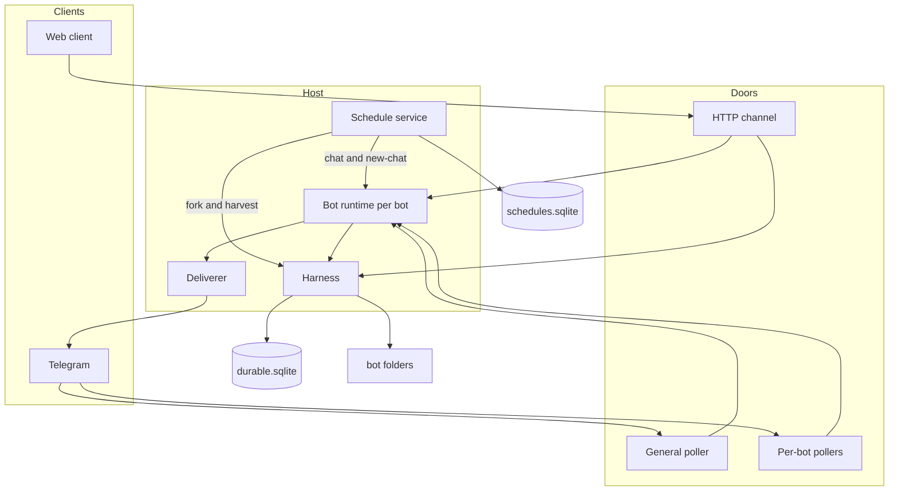

# Architecture

Several bots share one process and one durable session. Channels talk to a bot runtime, and so do schedule fires that land in a chat. A fire that forks a conversation talks to the harness directly. The runtime is the seam a later per-bot process would replace for doors and for chat fires. A user interface is a client of the same model: bots, chats, files, schedules, and a live transcript. The bundled web page is one such client.

The feature-level decisions live in [plans/](./plans/). This note keeps the shape. Screen layouts, the build order, and one-off product knobs stay there. Open work is tracked as GitHub issues.

- [Data model](./architecture/model.md) — bots, chats, files, session documents, schedules
- [Data flow](./architecture/flow.md) — inbound, a turn, outbound, fires, idle harvest
- [Client surface](./architecture/client.md) — the HTTP API another UI plugs into

## Components

The host (`startApp`) owns the process:

- **Storage lock and harness.** One opener of `durable.sqlite`. Session documents, conversations, and the model loop live here. The records are in the [data model](./architecture/model.md).
- **Bot runtimes.** One in-process handle per bot, all on that harness.
- **Deliverer.** Telegram sends, with receipts. The receipt rule is in [data flow](./architecture/flow.md).
- **Pollers.** One long-poll loop per Telegram door.
- **Schedule service.** Sidecar rows, an in-process clock, and the fire path. Chat and new-chat fires go through a runtime. Fork and harvest submit into a child conversation.
- **HTTP channel.** The API a client uses, plus the bundled page when a web credential is set. Resources are in the [client surface](./architecture/client.md).

Session services stay on the host. A bot runtime is not the lock, the deliverer, the poller, the clock, or the HTTP server.

### Bot runtime

Doors admit user text through `BotRuntime`. So do `chat` and `new-chat` schedule fires. A `fork` fire, including idle harvest, loads the parent conversation and submits into the child on its own. That child is not a chat-directory row and is not delivered. The paths are in [data flow](./architecture/flow.md).

- `submit` admits text on an existing chat and returns when that admission is durable. The reply is delivered in the background.
- `listChats` and `createChat` are the chat directory for that bot. `createChat` finds an existing chat or opens an ownerless conversation, configures it, and records the row in one commit.
- An edit through the API is picked up by chats created after it. Conversations that already exist keep the model, thinking level, and working directory they were given.

Inside the process every runtime is a handle on the shared harness. A later split replaces the handle with a client of another process. Doors, and chat and new-chat fires, stay on that handle. A fork stays with the storage owner, because the child is not a chat.

### Prompt, file tools, and self tools

Three extensions sit on the harness:

- Identity renders the bot folder into prompt sections when a request is built. The sections are in the [data model](./architecture/model.md).
- File tools are pi-durable `read`, `write`, and `edit`, aimed at an execution environment rooted at that bot's folder. There is no shell.
- Web tools are `web.search` and `web.fetch`. They POST to the xAI web endpoints. A repeat is another request, so their replay class is unsafe.
- Self tools (`pi-bot.self`) call host services for the bot that owns the conversation. The registry is built before those services exist, so the host object is filled in before a turn runs. Schedule create, list, update, and delete are the tools installed today. They read and write the sidecar for that bot only, and they never show or change a `harvest:` row. Creating, updating, or deleting a schedule is replay `safe` and memoized on the tool task, so recovery returns the same outcome instead of inserting, editing, or removing another row.

`write` and `edit` leave replay unset. The library treats that as unsafe: recovery does not run the tool again. It records that the call was interrupted and may have partially run. The model sees that result and the turn continues.

## Current policy

These are the knobs the running process uses. They are not separate subsystems.

- Bot ids match `[a-z0-9][a-z0-9-]{0,31}`. A slug that matches a bot id or an existing `bots/<id>/` directory gains a numeric suffix. Knowledge slugs match `[a-z0-9][a-z0-9-]{0,63}`.
- A knowledge `description` is one frontmatter line, 1–240 characters, and the frontmatter has no other keys.
- The knowledge section lists at most 80 valid files, in path order, then a count of the rest.
- Idle harvest waits 60 seconds unless `PI_BOT_HARVEST_DELAY_MS` overrides it. The delay is process-wide.
- Cron is five fields. A bad expression is rejected and writes nothing.
- Every registered tool (`read`, `write`, `edit`, the schedule tools, `web.search`, and `web.fetch`) is on unless the bot row lists an enabled set. An omitted `tools` field means all of them. An empty list means none. A disabled tool is left out of the model request and is not run. `GET` and `PUT /api/bots/<id>/tools` read and replace that set. The bot dialog shows the same switches.
- The host does not delete bots. It does not run a shell.
