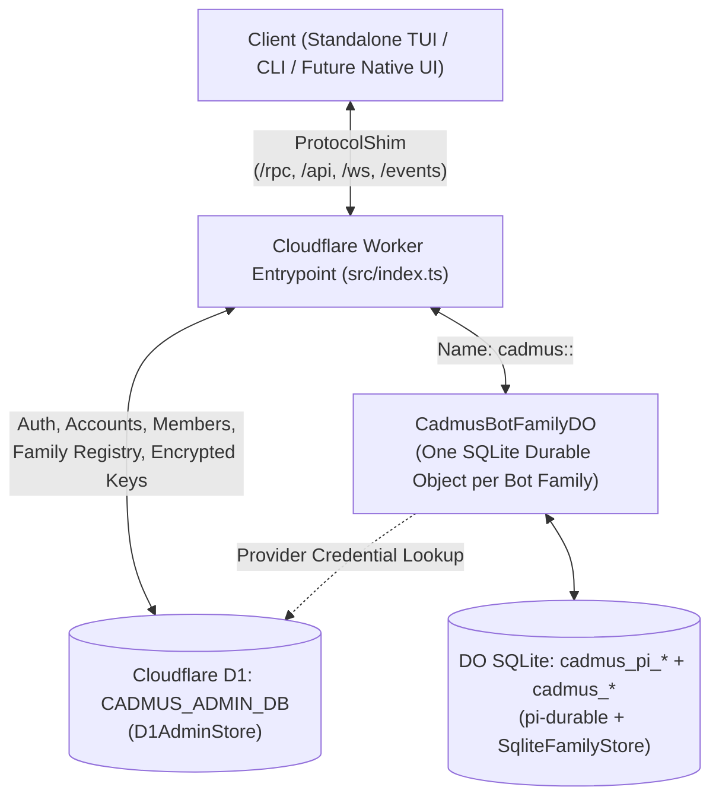

# Cadmus Architecture Overview

Cadmus is the cloud-native V2 runtime for `pi-bot`, built on **Cloudflare Workers**, **Cloudflare D1**, **SQLite-backed Durable Objects**, and `@earendil-works/pi-durable`.

This document serves as the **high-level architectural index**. Detailed design, schemas, and lifecycle flows live in focused sub-documents so this overview remains stable over time.

---

## High-Level Topology

---

## Core Architectural Pillars

1. **Global Admin vs. Family Conversation Storage Split**
   - **Global Admin Store (`D1AdminStore` on Cloudflare D1)**: Manages accounts, users/members, bearer tokens, AES-GCM encrypted LLM provider credentials, and the registry mapping `(accountId, familyId)` to Durable Object names (`cadmus:<accountId>:<familyId>`).
   - **Per-Family Store (`SqliteFamilyStore` + `pi-durable` inside `CadmusBotFamilyDO`)**: Everything required for low-latency bot turns, transcripts, virtual files (`SOUL.md`, `MEMORY.md`, `knowledge/<slug>.md`), schedules, and harvest watermarks lives inside the family's SQLite Durable Object behind the `FamilyStore` interface.
   - See **[Accounts, Multi-Tenancy & Storage Split](./architecture/accounts-and-storage.md)**.

2. **UI-Agnostic Protocol & Adapter Shims**
   - All interactions flow through a strongly-typed TypeBox protocol (`ClientCommand`, `CommandResultFrame`, `ServerEvent`) mediated by a pluggable `ProtocolShim` (`src/shim.ts`).
   - Supports HTTP RPC (`POST /rpc`), a REST translation of the same commands (`/api/*`), bidirectional WebSockets (`GET /ws`), and Server-Sent Events (`GET /events`).
   - Slash commands that inspect runtime state—specifically `/status`—are intercepted **out-of-band** before `conv.submit()` so they never pollute LLM conversation history or incur token costs.
   - See **[Protocol, Shims & Out-of-Band Commands](./architecture/protocol-and-turns.md)**.

3. **Out-of-Band Bot Files & Forked Idle Harvest**
   - Bot identity and knowledge (`SOUL.md`, `MEMORY.md`, and `knowledge/<slug>.md`) are stored in dedicated SQLite tables (`cadmus_bot_souls`, `cadmus_bot_memories`, `cadmus_bot_knowledge`) with Compare-And-Swap (`expectedVersion`) optimistic concurrency control—never inside `pi-durable` session docs.
   - When a chat goes idle after a turn, a one-shot internal schedule (`harvest:<chatKey>`) forks the conversation at the latest entry, runs a background extraction turn restricted to memory/knowledge tools, records unified diffs as a `HarvestNote`, and advances the chat's harvest watermark.
   - See **[Virtual Files, Knowledge Store & Idle Harvest](./architecture/knowledge-and-harvest.md)**.

4. **Unified Durable Schedules, Alarms & Inter-Bot Collaboration**
   - Cron (`5-field` timezone-aware), one-shot (`when`), and idle-harvest (`harvest:<chatKey>`) timers all share a single durable task primitive (`ScheduleTask` / `"cadmus.schedule"`) backed by `cadmus_schedules` and the Durable Object's hardware alarm (`ctx.storage.setAlarm`).
   - Bots within the same family can discover (`search_bot`), inspect (`list_bots`), spawn (`create_bot`), and converse (`chat_with_bot`) with sibling bots via durable `pi-durable` sub-tasks.
   - See **[Schedules, Alarms & Inter-Bot Collaboration](./architecture/schedules-alarms-and-bots.md)**.

---

## Sub-Documents Index

| Sub-Document | Scope |
| :--- | :--- |
| **[Accounts, Multi-Tenancy & Storage Split](./architecture/accounts-and-storage.md)** | `AdminStore` (D1) vs `FamilyStore` (DO SQLite), shared Cloudflare account `cadmus_` prefixing, auth modes (`cf-access`, `token`, `none`), and AES-GCM provider key encryption. |
| **[Protocol, Shims & Out-of-Band Commands](./architecture/protocol-and-turns.md)** | TypeBox `ClientCommand` / `ServerEvent` envelopes, `ProtocolShim` adapter layer, `/rpc` + `/api` + `/ws` + `/events` transports, standalone TUI boundary, and out-of-band `/status`. |
| **[Virtual Files, Knowledge Store & Idle Harvest](./architecture/knowledge-and-harvest.md)** | `BotFileStore` interface, `SOUL.md` / `MEMORY.md` / `knowledge/<slug>.md` limits & CAS versioning, `cadmus.identity` prompt assembly, and forked idle harvest with unified diffs. |
| **[Schedules, Alarms & Inter-Bot Collaboration](./architecture/schedules-alarms-and-bots.md)** | Unified `ScheduleTask` (`cron`, `when`, `harvest:<chatKey>`), `syncDurableObjectAlarm`, `SearchBotTask` / `ChatWithBotTask`, and `cadmus.tool-gate`. |
