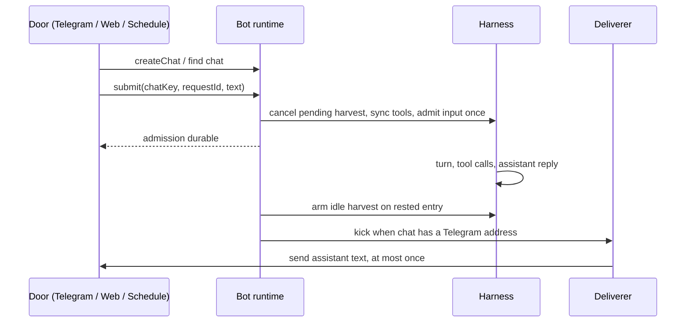

# Channels, Turn Lifecycle & Client API

Part of the [architecture](../architecture.md). Bot and chat records are in [Bots, Chats & Storage](./bots-and-storage.md). Prompt sections and harvest are in [Prompt, Knowledge, Memory & Idle Harvest](./knowledge-and-harvest.md).

## Inbound and turn flow

Every inbound message carries a deterministic `requestId` so retries or redeliveries are ignored:

| Source | Request id |
|---|---|
| Telegram message | `tg:<chatId>:<messageId>` |
| Web message | `<chatKey>:<clientMsgId>` |
| Schedule occurrence | `sched:<id>:<nextRun>` |
| Idle harvest child | `harvest:<chatKey>:<entryId>` |

When `submit` admits a new user message:
1. Any armed idle-harvest task for that chat is cancelled.
2. The conversation's offered tool list is synced to match the bot's current `tools` setting.
3. The input is submitted to the conversation with `whenBusy: "steer"` (`steeringMode: "all"`), so messages arriving mid-turn steer the active run at the next boundary. Native context compaction is enabled on the harness.
4. A background watcher waits for the submission to settle, warns if no text or tool call starts within 10 seconds, arms a new idle-harvest wake on the rested entry, delivers an `unanswered:<submissionId>` notice if the turn settled as unanswered (unless aborted/withdrawn), and kicks the deliverer.

A duplicate `requestId` neither cancels nor re-arms harvest and does not re-run the turn.

## Slash commands

`/new` (alias `/reset`), `/stop`, `/status`, `/help`, and `/start` share one command handler across Telegram and web chats:

- The command claims its `requestKey` in `pi-bot.telegram.commands` inside a commit before taking effect; redelivered commands are ignored.
- `/new` / `/reset` resets the conversation's visible model context while keeping prior entries stored.
- `/stop` aborts the in-progress conversation run.
- `/status` reports the bot's model, conversation id, and delivery receipt counts.
- On a web chat, the command response is appended as a notice in the transcript. On a Telegram chat, it is sent through the deliverer. Commands do not arm idle harvest.

## Telegram doors and outbound delivery

Two kinds of Telegram long-polling doors can run concurrently:
- **General door (`TELEGRAM_BOT_TOKEN`).** Polls when configured and a bot with id `default` exists, storing its update offset in `pi-bot.telegram.cursor` and routing messages to `default:tg:general:<chatId>[:<threadId>]`.
- **Per-bot doors (`bot.telegramToken`).** Each bot with a stored token runs its own poller and transport, storing its offset in `pi-bot.telegram.bot-cursors` and routing messages to `<botId>:tg:bot:<chatId>[:<threadId>]`.

Only Telegram user IDs listed in `TELEGRAM_ALLOWED_USERS` are admitted; others are ignored and logged. A poll offset advances only after the update has been durably admitted or handled.

Outbound Telegram delivery is **at most once**:
1. Before calling the Telegram API, the deliverer commits a `sending` receipt in `pi-bot.telegram.deliveries`.
2. It sends the message through the transport matching the chat key (`:tg:general:` vs. `:tg:bot:`).
3. On success it commits `sent` (with Telegram message IDs); on transport failure it commits `unknown`.
4. At process startup, before any turns resume, every `sending` receipt left from a prior crash is reconciled to `unknown`, logged, and surfaced in `/status`. An `unknown` receipt is **never resent**.
5. A periodic sweep (`PI_BOT_DELIVERY_SWEEP_MS`, default 15s) kicks delivery for any chat whose background watcher was lost.

Web chats have no Telegram address and are skipped by the deliverer. Posting a message from the web UI into a Telegram chat admits the message into that conversation and delivers only the assistant's reply to Telegram.

## Web channel and client API

The HTTP server listens when `WEB_TOKEN` is set. Requests authenticate via `Authorization: Bearer <WEB_TOKEN>` or the `HttpOnly` cookie set by opening `/?token=<WEB_TOKEN>`.

Resources are scoped by bot id or chat key:

- **Status and catalogs (`GET /api/status`, `GET /api/models`, `GET /api/tools`).** General Telegram door status (`{ telegram: boolean }`), offered model providers (`xai`, `faux`), and the installed tool catalog grouped by extension (`Knowledge`, `Schedules`, `Internal`, `Web`). No secrets are returned.
- **Bots (`GET /api/bots`, `POST /api/bots`, `PATCH /api/bots/:id`).** List, create, and update `name`, `model`, `thinking`, and enabled `tools`. Create and model changes fail with `422` when the model is unknown or its provider has no credentials. Responses include `telegramConfigured: boolean` and omit `telegramToken`.
- **Bot tools (`GET /api/bots/:id/tools`, `PUT /api/bots/:id/tools`).** Read and replace the enabled tool set (`{ enabled: string[] }`) for one bot, immediately syncing idle chats of that bot.
- **Telegram door (`PUT /api/bots/:id/telegram`).** Set or clear (`{ token: string | null }`) a bot's Telegram token, starting or stopping its poller.
- **Chats (`GET /api/bots/:id/chats`, `POST /api/bots/:id/chats`, `PATCH /api/chats/:key`, `DELETE /api/chats/:key`).** List a bot's live chats (with `opening` and `preview` snippets and whether the chat has a Telegram address), create a web chat (`{ chatId? }`), rename (`{ title }`), or close (`DELETE`).
- **Messages (`GET /api/chats/:key/messages`, `POST /api/chats/:key/messages`).** Read the projected chat transcript merged with harvest notes (`type: "harvest"`). Post `{ clientMsgId, text }` to submit a user message or slash command with request id `<chatKey>:<clientMsgId>`.
- **Entries (`GET /api/chats/:key/entries`).** Read the raw conversation log: every stored entry in ascending order, including system, reset, and tool-result rows omitted from the projected transcript.
- **Events (`GET /api/chats/:key/events`).** Server-Sent Events stream for one chat: `harvest`, `state`, `delta`, `tool`, `done`, `error`. On connect, stored harvest notes for that chat are sent first, followed by a `state` snapshot (including context token usage and model window).
- **Files (`GET /api/bots/:id/files`, `GET /api/bots/:id/files/:rel`, `PUT /api/bots/:id/files/:rel`).** List, read, and write `SOUL.md`, `MEMORY.md`, and `knowledge/*.md` (see [Prompt, Knowledge, Memory & Idle Harvest](./knowledge-and-harvest.md)).
- **Schedules (`GET /api/bots/:id/schedules`, `POST /api/bots/:id/schedules`, `PUT /api/schedules/:id`, `DELETE /api/schedules/:id`).** List, create, replace, and delete user schedules for a bot (see [Schedules, Extensions & Tool Policy](./schedules-and-tools.md)).

The bundled Preact web client is a stateless workspace over this API; it keeps no second copy of bots, transcripts, or files.
