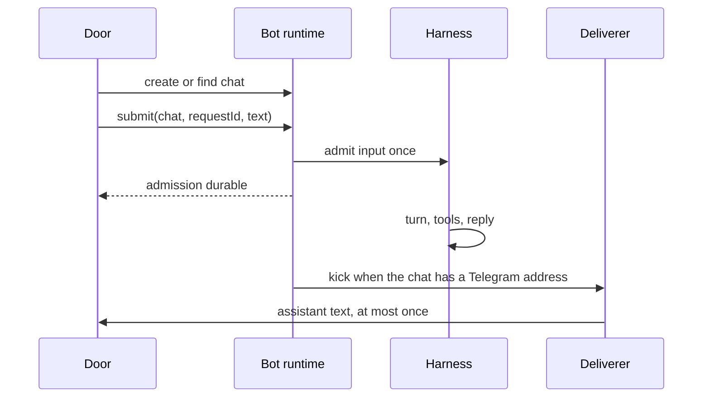

# Data flow

Part of the [architecture](../architecture.md). Records and files are in the [data model](./model.md). What a client calls is in the [client surface](./client.md).

## Inbound

Three request-id shapes make a repeat a no-op:

| Source | Request id |
|---|---|
| Telegram message | `tg:<chatId>:<messageId>` |
| Web message | `<chatKey>:<clientMsgId>` |
| Schedule occurrence | `sched:<id>:<nextRun>` |

A Telegram update's offset advances after that update has been handled. A web client supplies `clientMsgId`, so a retry of the same post admits once.

Slash commands (`new`, `reset`, `stop`, `status`, `help`, `start`) share one handler. The request key is claimed in `pi-bot.telegram.commands` before the effect. On a web chat the reply is a notice in the transcript. On a Telegram chat the reply goes out through the deliverer. Commands do not arm idle harvest.

A plain message calls `submit`. While a turn is in progress, further input steers that turn. After a newly admitted message, the host drops any idle-harvest wake for that chat. When that turn settles, the host arms a new one. A duplicate request id does neither.

## A turn

The conversation's agent directory is the bot folder from the [data model](./model.md). Prompt sections are read from that folder. Knowledge tools resolve `knowledge/<slug>.md` under it. `knowledge_update` and `knowledge_delete` are replay `safe` and memoized; a stale version does not write.

The web client watches the conversation. On connect, harvest notes already stored for that chat are sent first, then a `state` frame that includes the same notes. Later frames are `state` or `delta`, tool status, completion, errors, and `harvest`. The event names are listed on the [client surface](./client.md).

## Outbound

Telegram delivery commits a receipt as `sending` in `pi-bot.telegram.deliveries`, sends, then commits `sent` or `unknown`. A `sending` receipt found at startup becomes `unknown` and stays there. The deliverer does not resend it.

A web chat has no Telegram address, so the deliverer skips it. The client reads the transcript and the event stream.

A message typed on the web into a Telegram chat is admitted into that conversation. Telegram receives the assistant reply. The user's web text stays in the transcript the client reads.

A per-bot door has its own transport. Sends for `:tg:bot:` keys use that transport. Sends for `:tg:general:` keys use the process token. Those keys are defined on the [chat record](./model.md#chat).

## A schedule fire

Saving an enabled row creates a background `pi-bot.schedule` task on the bot's root conversation. The task sleeps until `nextRun`. The task claims `sched:<id>:<nextRun>` in `fires` before it dispatches. A second claim of that occurrence does nothing. A `put` or `reschedule` that lands while the occurrence is in progress leaves the claimed occurrence running and changes only what happens next.

The row shape is in [schedules](./model.md#schedules).

| Target | Effect |
|---|---|
| `chat` | `submit` into that chat. The reply is delivered when the chat has a Telegram address. `at` is ignored. |
| `new-chat` | create a web chat on the bot, with no user id, then `submit`. |
| `fork` | fork at the resolved entry, `submit` into the child. The child is not added to the chat directory and is not delivered. |

If the row's wake is still the one that was claimed, a `when` row is deleted and a `cron` row's next wake moves forward. The same task then sleeps until that next wake. A `when` task completes. A wake that is already past when the task runs goes immediately. A cron row then skips ahead rather than replaying every missed slot. A restart resumes the same task. Nothing scans the catalog at boot to create tasks.

## Idle harvest

Harvest is part of the bot runtime, not a schedule row. After a user turn settles, the runtime arms a background `pi-bot.harvest` task on the bot's root conversation. The task sleeps for the harvest delay ([current policy](../architecture.md#current-policy)), then forks that chat at the rested entry. A new user message aborts the task. The same rested entry only moves `until`. The wake lives on `pi-bot.harvest-notes`, not in `schedules.sqlite`.

The prompt says turns through `completed[chatKey]` are already stored, and the fork is skipped when no new user entry arrived after that watermark. When `SOUL.md`, `MEMORY.md`, or a file under `knowledge/` changed, it appends a note. The child conversation is owned by the task, so a crash attaches to that child. Completion writes `completed[chatKey] = entryId` even when no files changed.

The child is told to persist standing notes as a single source of truth (rewrite, do not changelog): voice and operating corrections via `memory_read` then `memory_update`; named facts (including home and country) via `knowledge_read` then `knowledge_update`; skip local answers and instance values. It is configured with only the knowledge tools the bot still has on (`knowledge_*` and `memory_*`). The parent transcript is unchanged. After restart, each chat is waited until idle; if that rested entry is not yet in `completed` and no wake is armed, one is armed. A live harvest task is left alone.

Before the fork, the host snapshots `SOUL.md`, `MEMORY.md`, and `knowledge/`. After the child goes idle, it diffs. No change means no note. A change appends `{ chatKey, at, files: [{ path, diff }], when }` on `pi-bot.harvest-notes`. The note is shown on that chat's timeline, collapsed until opened. It is not a conversation entry, so later model requests do not see it, and it is not sent to Telegram.

The schedule listing a client sees omits `harvest:*`. Those rows are not editable or deletable through the [client API](./client.md) or through the model's schedule tools.

## Model schedule tools

`schedule_create`, `schedule_list`, `schedule_update`, and `schedule_delete` run inside the turn, on the schedule service. The bot id is the conversation's working directory (`bots/<id>`), not an argument. A `chat` or `fork` target defaults to this chat and must be a live chat of that bot. `new-chat` is the same target the HTTP API accepts. An update changes only the fields it is given: message, name, enabled, cron or `when`, and target. A disabled row stays listed and does not fire on the clock.

The tools do not take a schedule id on create. They do not accept `harvest:` as something to update or delete. List results leave those rows out. A failed check (missing message, both cron and `when`, a cron that is not five fields, a chat on another bot, an update with no fields) returns an error to the model and writes nothing.

Create and delete record their outcome on the tool task. A replayed call returns that outcome and does not insert or remove a second row. List is a read.
