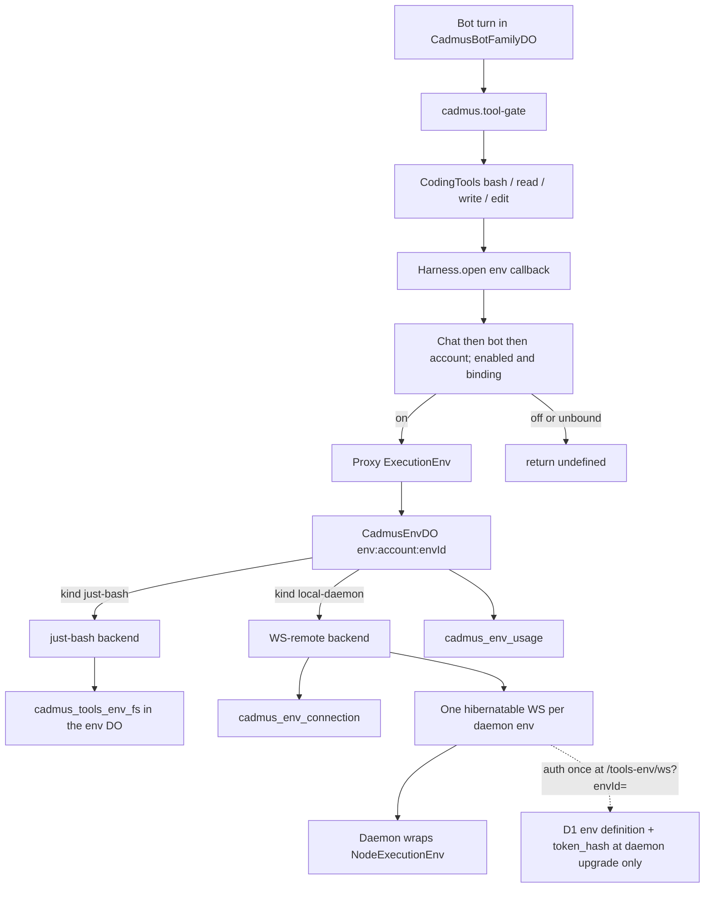

# Tools env — Plan Index

This directory is the architecture and sequencing plan for [GitHub issue #9](https://github.com/liorm/pi-bot/issues/9): give each Cadmus bot a **tools env**. A tools env is a bound [`ExecutionEnv`](https://github.com/earendil-works/pi/tree/main/packages/durable) from `@earendil-works/pi-durable` 1.3.0 (`ExecutionEnv extends FileSystem, Shell` in `dist/env/index.d.ts`). The model uses pi-durable's built-in coding tools (`bash`, `read`, `write`, `edit`). This plan does not add a Cadmus tool surface for shell or workspace I/O.

It is a plan. **No tools-env code exists in the tree today.** `CadmusBotFamilyDO.initHarness` calls `Harness.open` with `models`, `registry`, `settings`, and `onReport`, and no `env` callback ([`src/family-do.ts`](../../../src/family-do.ts)). `CodingTools` is not installed. The closest runtime surface is `code.execute` in [`src/extensions/web-tools.ts`](../../../src/extensions/web-tools.ts), a stub that xAI rewrites to the provider-native `code_interpreter` sandbox in [`src/models.ts`](../../../src/models.ts) (`NATIVE_TOOLS`). Self-hosting Cadmus with `celld` does not run bot commands.

Brain and memory are already durable. `SOUL.md`, `MEMORY.md`, and `knowledge/<slug>.md` live in the family Durable Object SQLite (`cadmus_bot_souls`, `cadmus_bot_memories`, `cadmus_bot_knowledge` in [`src/store/sqlite-family.ts`](../../../src/store/sqlite-family.ts)). A tools env covers **shell + optional scratch workspace only**.

Style of these notes follows [`docs/architecture.md`](../../architecture.md) and [`docs/architecture/`](../../architecture/). Citations are to functions and tables that exist in the tree, or to pi-durable 1.3.0, unless marked **(new)**.

Replaced: an earlier Cadmus-specific shell and file tool API and provider interface. See [builtin-tools.md](./builtin-tools.md) and [execution-env.md](./execution-env.md).

**Unify (2026-10-21, Lior).** Every tools env, including just-bash, is an account-scoped env. The family harness callback always returns the same proxy `ExecutionEnv`, which RPCs `CadmusEnvDO` (`env:<accountId>:<envId>`). Provider code (just-bash backend, WebSocket daemon backend, and later a sandbox manager) lives only behind that DO. just-bash does not run inside `CadmusBotFamilyDO`.

---

## Goals

1. The account has a catalog of tools envs and one **account default**. Every env is a D1 row in `cadmus_tools_envs` (kind + config) and one `CadmusEnvDO`. Account create inserts a built-in just-bash env `jb_default` and sets the account default to `{ envId: "jb_default" }`. The same insert-and-set runs once for existing accounts, in the branch that adds `default_tools_env_json`. A later explicit `null`, or a deleted `jb_default`, is left alone. A paired daemon is another row (`local-daemon`: workspace, confinement, pairing secret) with the same DO name shape. Any bot in any family references an env by `envId`. The operator may point the default at another env, or clear it (`null` means inheriting bots are unbound). A later Docker / microVM env manager ([issue #16](https://github.com/liorm/pi-bot/issues/16)) is another backend behind the same DO, and another `kind` on this catalog.
2. A bot and a chat each store a tri-state `toolsEnv`: inherit (`null`), on (`{ enabled: true, binding? }`), or off (`{ enabled: false, binding? }`). `binding` is `{ envId }` only. The account default is that same binding or `null`. Most specific explicit setting wins (chat → bot → account). Example: the account default is `jb_default`, one bot is on with a daemon `envId`, and a planning chat of that bot is on with a just-bash `envId`. A chat that inherits uses the bot, then the account. A chat or bot that is off has no env even when a higher level is on.
3. Return the effective environment from the `env` callback passed to `Harness.open`. The model reaches it through pi-durable `CodingTools` (`bash` / `read` / `write` / `edit`). The callback is uniform: resolved **off** or unbound returns `undefined`; a definition that exists and whose `getConnection()` is `disconnected` throws; otherwise the callback returns the proxy. Resolved **on** still requires the existing `bot.tools` opt-in. The tool gate blocks the four names when the env is off, regardless of `bot.tools`. Web tools and knowledge tools are unchanged.
4. Keep the bot fully usable when the effective environment is down or off: chat, soul/memory/knowledge, schedules, harvest. Off → callback `undefined`, coding tools not offered. Disconnected daemon → callback throws a clear offline error (`env offline` / `env disconnected`). Chat and the other tools keep working. A chat whose env is just-bash stays up while a daemon env is disconnected, because those are two env DOs. just-bash `getConnection()` is always `connected`.
5. The daemon reconnects on its own. **Decision 1 (20 Oct 2026) is superseded (2026-10-21, Lior).** No cloud-side probing, no DO-alarm probe ladder, no `next_probe_at`. A missed heartbeat or a socket failure marks that daemon env disconnected and fails in-flight calls. A tool call that arrives while disconnected fails fast. Heartbeat and generation CAS apply to the WebSocket backend only. just-bash uses the same RPC surface, the same in-flight registry, and the same error classes, and it has no socket and no heartbeat. Details in [reachability.md](./reachability.md).
6. Treat workspace persistence as a **flag on the env definition**, not a separate subsystem and not a per-bot inline flag. just-bash `persist: true` keeps that env's VFS in the env DO's SQLite. `persist: false` keeps it in a map in that env DO's isolate. Both are capped at 8 MiB per namespace. The daemon folder belongs to the account env and is shared by every bot that references that `envId`. Never sync or promote workspace files into knowledge. A chat that pins its own `envId` uses a `chat:<chatKey>` namespace and does not share the bot namespace.

just-bash pays one extra DO RPC hop per op (same-colo, typically small) in exchange for the uniform model.

## Non-Goals

- A second shell and file tool API beside pi-durable's coding tools.
- Replacing `SOUL.md` / `MEMORY.md` / `knowledge/*.md` with a real filesystem.
- Mounting or copying between the scratch workspace and `BotFileStore`.
- A per-chat tool allowlist. `bot.tools` still decides which of `bash` / `read` / `write` / `edit` may be offered. Chat-level **off** hides all four for that conversation; it does not pick a subset. The chat field also chooses which env those tools use when on.
- A `HarvestTask` or a second alarm driver. Family alarms stay schedules and harvest ([`src/alarms.ts`](../../../src/alarms.ts)). The env DO does not arm an alarm while its socket is idle, and it does not probe. A just-bash env has no socket and arms no heartbeat.
- Making `code.execute` the tools-env backend. It stays the xAI-native sandbox, with no workspace.
- Installing `createPowerShellTool` (pi-durable ships it separately from `CodingTools`).
- Heartbeats on an idle daemon socket, and any heartbeat on a just-bash env. A daemon heartbeat runs only while tool calls to that env are in flight.
- Docker and microVM sandbox managers. Workspace confinement for just-bash and the local daemon is `confineToWorkspace` (decision 14). See [Deferred](#deferred) and [issue #16](https://github.com/liorm/pi-bot/issues/16).

---

## Deferred

Docker and microVM sandbox **managers** moved to [issue #16](https://github.com/liorm/pi-bot/issues/16). Both need a manager that spawns and destroys sandboxes — a separate lifecycle, resource limits, and cleanup — and that work should not block the two backends above. The manager plugs in later as another backend **behind `CadmusEnvDO`**. The family callback still returns the same proxy. This plan does not specify that manager. Workspace confinement (`confineToWorkspace`) for just-bash and `local-daemon` is in this plan, not #16.

---

## Decisions (design call, 20 Oct 2026)

| # | Decision | Plan doc |
| :--- | :--- | :--- |
| 1 | **Superseded (2026-10-21, Lior).** The 20 Oct text (per-scope rows in `CadmusBotFamilyDO`, DO-alarm probes, three probes 5 minutes apart, then `next_probe_at` null) is withdrawn. The daemon, and every future manager that keeps a connection ([issue #16](https://github.com/liorm/pi-bot/issues/16)), reconnects on its own: exponential backoff with jitter, capped (1s, double, cap 60s, ±20%). No cloud-side probe, no probe alarm, no `next_probe_at` / `probe_attempt`. Connection state for a WebSocket backend is one row on `CadmusEnvDO` (`env:<accountId>:<envId>`): `connected` or `disconnected`, monotonic `generation`, CAS on every disconnect. Reconnect writes `connected` and bumps generation in one statement; reconnect means ready. Heartbeat every 30s only while tool calls to that WebSocket env are in flight (env DO sends an app-level heartbeat, daemon replies, missed reply fails the calls). Idle sockets have no heartbeat and no alarm. The timer is `setTimeout` while the isolate is pinned by those RPCs, not a DO alarm. A missed heartbeat or a socket error closes the socket, fails in-flight calls with transport `env disconnected`, and CAS-marks `disconnected`. A call that arrives while disconnected throws the offline error and does not start recovery. Off still returns `undefined`. just-bash is always `connected` on this same DO class: same RPC surface, same in-flight registry, same error classes, no socket, no heartbeat, no generation row. Toggle-off does not close a shared daemon socket and does not drop a just-bash VFS. `409` confinement stops the daemon's backoff until config changes. | [reachability.md](./reachability.md) |
| 2 | Workspace persistence is configured **on the env definition**: just-bash VFS in that env DO's SQLite (`persist` true) or in that env DO's isolate map (`persist` false), or the daemon folder on the owner machine (persistent by nature). Both just-bash modes live in the env DO. Docker volumes and microVM disks are [issue #16](https://github.com/liorm/pi-bot/issues/16). Toggling a level **off** retains the namespace and the daemon folder; inherit (`null`) of a chat pin drops that chat namespace in the env DO. | [workspace-persistence.md](./workspace-persistence.md) |
| 3 | No promotion to knowledge. Durable notes go through `knowledge_read` / `knowledge_update` / `knowledge_delete` and `memory_read` / `memory_update` in [`src/extensions/knowledge-tools.ts`](../../../src/extensions/knowledge-tools.ts). | [workspace-persistence.md](./workspace-persistence.md) |
| 4 | `BotRecord.toolsEnv` **(new)** is `ToolsEnvSetting`: `{ enabled, binding? } \| null`. `binding` is `{ envId }` for every kind. Kind, `persist`, `confineToWorkspace`, `sharedWorkspace`, `workspacePath`, and the pairing secret live on the account env definition in D1. The secret is AES-GCM in `cadmus_tools_env_secrets`, same pattern as `cadmus_account_credentials` — never plaintext in a DO, and not scoped to a family. | [binding-and-config.md](./binding-and-config.md) |
| 5 | `ChatRecord.toolsEnv` **(new, optional)** is the same `ToolsEnvSetting`. Absent or `null` means inherit. `{ enabled: false }` is off for that chat even when the bot is on. `{ enabled: true }` is on even when the bot is off. just-bash namespaces inside the env DO are `bot:<botId>` or `chat:<chatKey>`, following the binding source, qualified by `family_id` unless that env sets `sharedWorkspace`. A chat that inherits both enabled and binding does not get its own namespace. A bot that inherits the account just-bash default still uses `bot:<botId>` in `jb_default`, so two bots do not share a VFS. Daemon reachability and the socket are that env DO, not a family scope. A chat that inherits a daemon `envId` uses that env's folder. | [binding-and-config.md](./binding-and-config.md), [execution-env.md](./execution-env.md) |
| 6 | The tools env and its coding tools are an identity section in `cadmus.identity`. While the derived status is `connected` (just-bash always is), section `tools-env` describes the env and names `bash` / `read` / `write` / `edit`, and says `code.execute` is a provider sandbox with no workspace files. While a daemon env is `disconnected`, that section is omitted and `tools-env-unavailable` is rendered instead: it does not name those four tools. It says the workspace env is unavailable and that the environment reconnects on its own, and that `code.execute`, if enabled, remains that sandbox and cannot see the workspace. `SYSTEM_PROMPT` stays memory and knowledge only. | [builtin-tools.md](./builtin-tools.md) |
| 7 | just-bash VFS is capped at **8 MiB** per namespace, in the env DO's SQLite and in its isolate map. A namespace is the scope (`bot:<botId>` or `chat:<chatKey>`) qualified by family when `sharedWorkspace` is false, or the scope alone when it is true. A write past the cap is `FileError` `invalid` and leaves the just-bash env `connected` (it has no connection row). No per-file cap. | [workspace-persistence.md](./workspace-persistence.md) |
| 8 | One account env may be referenced by many bots, including bots in different families. That includes just-bash. The daemon opens **one** `/tools-env/ws?envId=` to `CadmusEnvDO`. Families do not each hold a socket, and they do not each hold a just-bash VFS. `account.toolsEnvs.list` returns every env row, including the built-in `jb_default`. `AccountRecord.defaultToolsEnv` is `{ envId }` or null. After account create it is `{ envId: "jb_default" }`. | [binding-and-config.md](./binding-and-config.md) |
| 9 | just-bash applies a **5s** ceiling when `bash` passes no timeout. That result is `ExecutionError` `timeout` (application). A missing daemon reply is transport. | [builtin-tools.md](./builtin-tools.md), [execution-env.md](./execution-env.md) |
| 10 | `create_bot` takes an optional `toolsEnv` (`ToolsEnvSetting`). Omitted leaves the new bot inheriting the account default. The tool may pin on, pin off, or name an existing `envId`. It cannot mint a token and cannot create an env. | [binding-and-config.md](./binding-and-config.md) |
| 11 | Harvest forks get neither a tools env nor coding tools. `HARVEST_TOOLS` stays knowledge and memory. The harvest child is marked so the `env` callback returns `undefined`. | [execution-env.md](./execution-env.md), [builtin-tools.md](./builtin-tools.md) |
| 12 | just-bash implements symlinks, including shell `ln -s` (the conformance suite has no other way to create one) and a polling watch that reports a watched symlink when its target changes. Conformance runs the proxy against the just-bash env DO and uses the suite default `symlinks: true`. | [execution-env.md](./execution-env.md) |
| 13 | Tools env is tri-state at bot and chat: inherit (`null`), on (`{ enabled: true, binding? }`), off (`{ enabled: false, binding? }`). Account stays the default binding. Resolution is chat → bot → account; first non-inherit `enabled` wins; first explicit `binding` wins independently. `enabled: true` with no resolvable binding is rejected on write and treated as off at runtime. Off → `env` returns `undefined` and coding tools are not offered; a disconnected daemon still throws. | [binding-and-config.md](./binding-and-config.md), [builtin-tools.md](./builtin-tools.md) |
| 14 | `confineToWorkspace` lives on the env definition for every kind. Each provider declares `supportsConfinement`. Requesting it on a provider that does not support it is rejected at validation. just-bash is inherently confined (the VFS is the whole world): the row stores true, and `false` is rejected. The daemon enforces file-path realpath jails and requires an OS-level mechanism for `bash`; it refuses to start confined when that mechanism is missing. It declares that mechanism on the upgrade request (`X-Cadmus-Env-Capabilities: confinement`). `CadmusEnvDO` returns `409` before `acceptWebSocket` when the env requires confinement and the token is absent (`last_error = confinement_unavailable` when no socket is connected; a live socket is left alone). The daemon stops its reconnect loop until config changes. Capability is not a WebSocket frame. Full isolation (containers / microVM) remains [issue #16](https://github.com/liorm/pi-bot/issues/16). | [execution-env.md](./execution-env.md), [binding-and-config.md](./binding-and-config.md) |
| 15 | `CadmusEnvDO` serializes write/edit-style file ops per canonical path with an in-memory queue, for every backend, including just-bash. `bash` / `exec` is not in that queue. pi-durable's per-harness `withFileMutationQueue` still runs; it does not order two families that do not share an isolate. The env DO does, because both families' traffic already goes through it. The queue is not durable: isolate death fails the in-flight RPCs. | [reachability.md](./reachability.md), [execution-env.md](./execution-env.md) |
| 16 | **Unify (2026-10-21, Lior).** All envs go through `CadmusEnvDO`. just-bash is an account env definition and a backend inside that DO. Its VFS table is env-DO SQLite (`cadmus_tools_env_fs`), namespaced by scope and, unless `sharedWorkspace` is set, by family. The family holds a proxy and no VFS. One minimal accounting hook records ops, bytes, bash runtime, and errors on the env DO. Phase 1 ships the DO, the just-bash backend, the proxy, the D1 definition, and that hook. Phase 3 adds the WebSocket backend, heartbeat, generation CAS, and the daemon. | [execution-env.md](./execution-env.md), [sequencing.md](./sequencing.md) |

---

## Why every env is an env DO

- **Isolation per env.** Each env has its own Durable Object, its own SQLite, and its own CPU budget, separate from the family DO and from every other env.
- **One place for management.** Definitions live in D1. Runtime, VFS, sockets, the in-flight registry, and the per-path queue live in `CadmusEnvDO`. The family only resolves a binding and returns a proxy.
- **Accounting and usage metering.** The env DO counts ops, bytes, bash time, and errors per caller. See the hook in [execution-env.md](./execution-env.md).
- **Limits and audit.** A pre-op check in the env DO is where a later limit reads those counters. The rollup is the audit trail. Phase 1 records counters and does not add a product quota beyond the 8 MiB namespace cap.

---

## Where state lives (existing split)

Rule of thumb from [`docs/architecture/accounts-and-storage.md`](../../architecture/accounts-and-storage.md):

| Kind of state | Store | Why |
| :--- | :--- | :--- |
| Bot tools-env setting (`ToolsEnvSetting`) | Family DO SQLite `cadmus_bots.tools_env_json` **(new column)** | Inherit / on / off for the bot. Read when a chat inherits. The binding is an `envId`. |
| Chat tools-env setting | Family DO SQLite `cadmus_chats.tools_env_json` **(new column)** | Read on every `env` callback for that chat. Null inherits the bot setting. `{ enabled: false }` is off for this chat. |
| Conversation → chat | Family DO SQLite `cadmus_chat_conversations` **(new)** (`tools_env_enabled`: 1 normal, 0 harvest child) | Forks are not chat rows. The callback must not call `harness.commit` (it can already be on the session line). The creating hook writes the row with synchronous family-store SQL inside the pi-durable commit. `ensureSchema` backfills existing `cadmus_chats` and does not read `cadmus_pi_*`. Harvest deletes its child row after the fork settles. Other fork rows stay. |
| Env definition | D1 `cadmus_tools_envs` **(new table)** | Account-scoped kind and config. just-bash: `persist`, `confine_to_workspace`, `shared_workspace`. Daemon: those confinement and persist flags, plus `workspace_path` and `secret_id`. Bots reference `envId`. |
| Account default binding | D1 `cadmus_accounts.default_tools_env_json` **(new column)** | `{ envId }` or null. Account create sets `{ envId: "jb_default" }`. Same row as name and timezone ([`AccountRecord`](../../../src/protocol/records.ts)). The family DO caches the JSON (no token) and reads it when bot and chat have no pin. `account.update` and env-definition writes fan that cache out to every family DO of the account. |
| just-bash persisted VFS | `CadmusEnvDO` SQLite `cadmus_tools_env_fs` **(new)** | Primary key `(family_id, scope, path)`. `scope` is `bot:<botId>` or `chat:<chatKey>`. Private envs set `family_id` so two families' bot ids cannot collide. `sharedWorkspace` stores `family_id` as `''` and those families share that scope. `bot_id` is denormalized for delete. Not in the family DO. Not a pi-durable session `Doc`. |
| just-bash ephemeral VFS | Map in the `CadmusEnvDO` isolate, keyed by the same namespace | `persist: false` only. Empty after that DO's eviction or restart. Same 8 MiB cap. |
| Usage rollup | `CadmusEnvDO` SQLite `cadmus_env_usage` **(new)** | Hour and day buckets per caller (family, bot, chat) and op kind. Optional later export to D1 or Analytics Engine. |
| Daemon connection | `CadmusEnvDO` SQLite `cadmus_env_connection` **(new, phase 3)** | One row per WebSocket env. just-bash does not write this table. Not in the family DO. |
| Pairing token (`secretId`, `daemon_token`) | D1 `cadmus_tools_env_secrets` **(new table, AES-GCM)** | Same reason as BYOK keys in `D1AdminStore.setCredential` / `encryptJson` ([`src/store/d1-admin.ts`](../../../src/store/d1-admin.ts)). Keyed by `account_id`. `set` mints `cadmus_dt_` + 64 hex and returns it once. `token_hash` is for the upgrade lookup. No `family_id`. The daemon env definition points at `secret_id`. just-bash rows have no secret. Bots themselves are not in D1. |
| LLM provider credentials | D1 `cadmus_account_credentials` (existing) | Unchanged. |
| Transcripts, turns, durable tasks | `pi-durable` session (`cadmus_pi_*`) | Unchanged. The workspace is not a session `Doc`. |

There is no `cadmus_tools_env_state` and no `cadmus_tools_env_fs` on the family DO.

---

## Topology (target)

`initHarness` installs `CodingTools` and passes `env`. The callback resolves conversation → chat (walking a Cadmus parent map for forks) → `resolveToolsEnv` (chat setting, bot setting, account default). Harvest child, resolved off, and unbound return `undefined` before building an env. Every resolved **on** binding returns the proxy. The proxy RPCs `CadmusEnvDO`. That DO runs the just-bash backend or, in phase 3, the WebSocket backend. The family holds no env socket and no VFS. Cloudflare-hosted Cadmus reaches **just-bash** through the env DO (one same-colo RPC per op). The **local daemon** dials that same class of DO; the cloud never opens an inbound port on the owner's LAN. The pairing row yields the account and is checked against the daemon env definition. One env, one DO, every family that references that `envId`. Family `broadcastEvent` stays the protocol sockets it already has; daemon sockets are not in that DO. Self-hosted `celld` does not change the dial-out default. A later sandbox manager is another backend on this DO ([issue #16](https://github.com/liorm/pi-bot/issues/16)).

---

## Document index

| Document | Scope |
| :--- | :--- |
| **[execution-env.md](./execution-env.md)** | Uniform `env` callback, proxy, backend interface, accounting hook, tri-state resolution, `EnvTarget.cwd` vs the env's real `cwd`, `ExecutionEnv.id`, just-bash and the WS-remote backend, `confineToWorkspace`, wire protocol, `/tools-env/ws` routed to `CadmusEnvDO`. |
| **[builtin-tools.md](./builtin-tools.md)** | Installing `CodingTools`, per-bot gate, env-off removing coding tools, the `bot.tools === undefined` default, image `read` on Workers, relation to `code.execute`, identity sections `tools-env` and `tools-env-unavailable`. |
| **[reachability.md](./reachability.md)** | `CadmusEnvDO` for every kind, WebSocket connection row, generation CAS, heartbeat only while daemon calls are in flight, proactive daemon backoff, offline throw vs off `undefined`. No cloud probes. |
| **[workspace-persistence.md](./workspace-persistence.md)** | Persistence on the env definition; namespaces inside the just-bash env DO; `sharedWorkspace`; retain on toggle off; no knowledge mount/sync/promotion. |
| **[binding-and-config.md](./binding-and-config.md)** | Account catalog and built-in default, `ToolsEnvSetting` tri-state, `{ envId }` binding, D1 secrets, validation, `account.toolsEnvs.list`, `bot.create` / `bot.update`, `chat.create` / `chat.update`, `create_bot`, web + TUI. |
| **[sequencing.md](./sequencing.md)** | Shippable phases, dependencies, conformance + e2e test strategy. |

---

## Resolved

The earlier open questions are decisions 7–16. Decision 1's cloud-side probing is superseded (2026-10-21, Lior); the replacement is in the decision 1 row and in [reachability.md](./reachability.md). Decision 16 puts just-bash on the same env DO. Issue #16 still owns the Docker / microVM env-manager kind (spawn per bot, or per tool call) as a later backend on that DO and as a catalog kind. A manager that keeps a connection uses the WebSocket lifecycle (proactive reconnect, heartbeat while in flight, generation CAS). This plan does not specify that manager. Workspace confinement is decision 14.

## Closed

`local-daemon` with `persist: false` used to share one `${workspacePath}/.cadmus-ephemeral` across scopes, and a per-family "last binding" read could delete scratch another family still had configured. That race is closed: the workspace belongs to the account env. Every bot and family that references the `envId` shares that folder, including `.cadmus-ephemeral`. Unbinding one bot does not delete it. `deleteEphemeral` is sent only when the env definition is deleted or its `persist` flag changes, and the daemon has no other live session on that cwd. Per-bot subdirectories stay out: they would split `ExecutionEnv.id` (`daemon:<accountId>:<envId>`). Two different env definitions aimed at the same host path are still two folders from Cadmus's point of view and can overwrite each other on disk; that is an operator choice, not a per-family bookkeeping gap.

just-bash used to keep `cadmus_tools_env_fs` in the family DO, one interpreter per family. That split is closed: the table and the interpreter live in the env DO, and a private namespace includes `family_id` so two families that both have a bot id `assistant` do not share files unless `sharedWorkspace` is set on that env.
