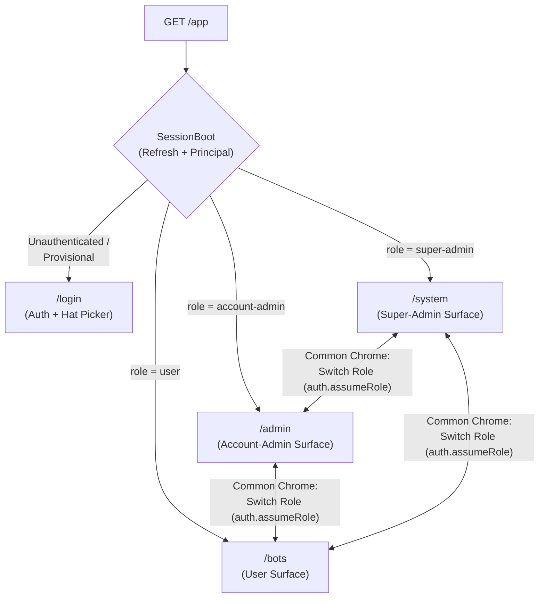

# Cadmus Web UI — Information Architecture, Personas & User Journeys

> **Status**: Production Architecture (Implemented for Issues `#10` & `#110`)
> **Scope**: `@cadmus/web-app` (`/app`) across **Super-Admin**, **Account-Admin**, and **User** personas on **Desktop** and **Mobile**.

This document defines the mental model, persona boundaries, device form-factor strategy, common identity chrome, route table, and core user journeys for the Cadmus Web UI. Its primary job is to act as a **routing rulebook for future features**: whenever a new backend capability or workflow is added to Cadmus, this document answers **which persona surface owns it, how it behaves on desktop vs. mobile, and whether it requires admin elevation**.

---

## 1. Guiding Principles

1. **One Session, One Hat (Persona-First Surfaces)**
   - A Cadmus session is bound to a single `(role, accountId)` principal:
     - `super-admin` in `system`
     - `account-admin` in `<accountId>`
     - `user` in `<accountId>`
   - Each persona lands on its **own dedicated application surface** with its own navigation, information hierarchy, and mental model. There is no shared "chat sidebar" forced onto admins, and no monolithic mixed `/settings` dumping ground.
   - Switching roles uses `POST /api/auth/assumeRole` (starting a fresh session under the target `(role, accountId)` hat and landing directly on that persona's home view).

2. **Infra-Light Account Admin**
   - **`super-admin`** owns **system governance & operations** across tenants (never tenant chat content).
   - **`account-admin`** owns **account governance only**: account profile/timezone, members & invites, AI provider credentials (BYOK / OAuth), and the account audit log.
   - **`user`** owns **all daily workspace operations**: single continuous bot conversations (`bot:<botId>`), bots CRUD (including delete), `/.cadmus/*` virtual files (`SOUL.md`, `MEMORY.md`, `skills/<slug>/SKILL.md`), idle harvest diffs, schedules, **Bot Groups (families)**, **Tools Environments**, search, and archive.
   - An account admin who wants to work with bots, bot groups, or tools environments switches to their `user` hat via the common role switcher.

3. **Single-Conversation Continuous Bot Streams (Issue `#10`)**
   - In the **User** surface, each bot is a **single continuous, persistent conversation stream** (`bot:<botId>`).
   - **Automatic Background Compaction** (`pi.compaction` / `DEFAULT_CADMUS_COMPACTION_POLICY`) summarizes older turns asynchronously when approaching the context threshold (`backgroundTokens` / `reserveTokens`) without freezing active turns.
   - The UI represents compaction natively inside the stream:
     - **Inline expandable Compaction Dividers** (*"Compacted · View summary"* showing summarized content and `firstKeptEntryId`).
     - **Reset Dividers** preserving prior user-visible history after `chat.reset`.
     - **Subtle Context & Compaction Indicator** in the stream header, plus non-blocking live progress driven by `chat.compaction` WebSocket events.
   - Scheduled job outputs and inter-bot group collaborations appear as structured panels/drill-downs rather than cluttering primary bot contacts.

4. **Unified `/.cadmus/*` Bot Virtual Filesystem**
   - Stored per bot behind CAS-versioned DO SQLite storage:
     - `/.cadmus/SOUL.md` — Bot persona & operating prompt
     - `/.cadmus/MEMORY.md` — Evolving factual memory (updated by bot file tools & idle harvest)
     - `/.cadmus/skills/<slug>/SKILL.md` — Reusable procedural skills editable by both user and bot
   - Non-`/.cadmus` file paths belong to the workspace **Tools Environment** (`tools-env`).

5. **Form-Factor Native per Persona (No Forced One-Size-Fits-All)**
   - **`user`** gets **first-class, form-factor-native** layouts on both **Desktop** (`>= 768px`, collapsible unified sidepanel + stream canvas + slide-over `/.cadmus/` drawer) and **Mobile** (`< 768px`, 4-tab bottom bar + messenger contact list + full-screen stream view).
   - **`account-admin`** and **`super-admin`** are **Desktop-first operational consoles** (structured tables, split inspectors, metrics, audit filters). On **Mobile (`< 768px`)**, they render a dedicated **Mobile Triage & Quick-Actions** surface without horizontal scrolling.

6. **First-Class In-Place Admin Elevation**
   - Both `super-admin` and `account-admin` sessions open in **Read-only** mode by default.
   - Elevation ("Admin mode") is surfaced as a persistent **top-bar lock pill** (`Read-only · Arm` ↔ `Armed · MM:SS` countdown).
   - Attempting any protected mutation while read-only triggers `runProtected(...)` in `ElevationContext`, presenting an **inline elevation prompt in place** (`InlineElevationDialog`) — arming via `auth.elevate` and immediately completing the action.

7. **Common Identity & Chrome (Every Persona)**
   - Every persona renders a single **Identity Chip** in its own navigation bar opening the common **Identity Drawer** (`IdentityDrawer`) for:
     - Role / Account switching (`auth.assumeRole`)
     - Active sessions & login methods (`auth.sessions.*`, `auth.methods.*`)
     - Theme preference (`dark` / `light` / `sepia`)
     - Sign Out
   - Every **"Add / Create / Invite / Pair"** action across all 3 personas uses `AddEntityDialog` (**Centered Modal** on Desktop, **Slide-up Bottom Sheet** on Mobile) — never inline-inserted form divs.

---

## 2. Persona × Capability Ownership Matrix

Use this table whenever adding or moving a feature. Every capability has **exactly one** owning surface.

| Domain / Capability | Super-Admin (`system`) | Account-Admin (`account`) | User (`workspace`) | Common Chrome (All) | Requires Elevation? |
| :--- | :---: | :---: | :---: | :---: | :---: |
| System Metrics (`system.metrics`) | **Owner** | — | — | — | Read: No |
| Tenant Accounts (`system.accounts.*`) | **Owner** | — | — | — | Mutate: **Yes** |
| Session Revocation (`system.sessions.revoke`) | **Owner** | — | — | — | **Yes** |
| System Audit Log (`system.audit.list`) | **Owner** | — | — | — | Read: No |
| Account Profile (name, timezone) | — | **Owner** | — | — | Mutate: **Yes** |
| Account Members & Invites (grant/revoke/remove) | — | **Owner** | — | — | Mutate: **Yes** |
| AI Providers / BYOK & OAuth Credentials | — | **Owner** | — | — | Mutate: **Yes** |
| Account Audit Log (`account.audit.list`) | — | **Owner** | — | — | Read: No |
| Continuous Bot Streams (`bot:<botId>`) & Live Turns | — | — | **Owner** | — | No |
| Compaction History & Context Window Meter | — | — | **Owner** | — | No |
| Bots (`bot.create`, `bot.update`, `bot.delete`) | — | — | **Owner** | — | No |
| Bot VFS Files (`/.cadmus/SOUL.md`, `MEMORY.md`, `skills/<slug>/SKILL.md`) | — | — | **Owner** | — | No |
| Idle Harvest Diffs & Audit Trail | — | — | **Owner** | — | No |
| Schedules (cron & one-shot timers) | — | — | **Owner** | — | No |
| **Bot Groups / Families** (`family.create`, `family.update`, `family.delete`) | — | — | **Owner** | — | No |
| **Tools Environments** (`account.toolsEnvs.*`) | — | — | **Owner** | — | No |
| Search & Read-only Historical Archive | — | — | **Owner** | — | No |
| Switch Role / Account (`auth.assumeRole`) | — | — | — | **Owner** | No |
| Active sessions & login methods (`auth.sessions.*`, `auth.methods.*`) | — | — | — | **Owner** | No |
| Admin Elevation Pill (`Read-only` / `Armed`) | Shown | Shown | Hidden | Admin Chrome | Self-elevates |
| Theme (`dark` / `light` / `sepia`) & Sign Out | — | — | — | **Owner** | No |

---

## 3. Persona × Device Strategy Matrix

| Persona | Primary Device | Desktop (`>= 768px`) Experience | Mobile (`< 768px`) Experience |
| :--- | :--- | :--- | :--- |
| **Super-Admin** | Desktop | Left system nav (`System Metrics`, `Tenant Accounts`, `System Audit`), tenant table with right Quick Inspector & Expandable `/system/tenants/$accountId` detail page. | **Mobile Triage**: System pulse KPIs + tenant list with quick Suspend/Reactivate & `+ Tenant` bottom sheet. |
| **Account-Admin** | Desktop | Left section sidebar (`Overview`, `Members`, `Providers`, `Audit`) + top-bar `ElevationPill` & `IdentityChip`. Infra-light scope strictly enforced. | **Mobile Triage**: Account snapshot + quick `+ Invite` bottom sheet, member removal, BYOK toggles, `ElevationPill`. |
| **User** | Both Desktop & Mobile | Single unified collapsible left sidepanel (`w-80`/`w-14`) with Bot Groups pills, bottom section tabs (`Bots`, `Schedules`, `Envs`, `Skills`), top `IdentityChip`, full continuous stream canvas + slide-over `/.cadmus/` drawer. | 4-tab bottom bar (`Bots`, `Schedules`, `Envs`, `Skills`) + top-right avatar `IdentityChip`, contact list -> full-screen continuous stream with `/.cadmus/` modal sheet. |

---

## 4. Persona Routing & Session Flow

---

## 5. Production Route Namespace

| Persona | Route | View |
| :--- | :--- | :--- |
| Any (role-gated index) | `/` | Redirects to `/bots` (`user`), `/admin` (`account-admin`), or `/system` (`super-admin`) |
| `user` | `/bots` | Bot Groups + Bot directory + Desktop continuous stream for active bot |
| `user` | `/bot/$botId` | Focused continuous stream for `bot:$botId` (`/.cadmus/` VFS drawer, compaction dividers) |
| `user` | `/schedules` | Family schedule manager & cron/relative/absolute schedule editor |
| `user` | `/envs` | Tools Environments manager (just-bash & local daemon pairing/rotation/removal) |
| `user` | `/skills` | Cross-bot `/.cadmus/skills` & harvest explorer |
| `user` | `/search` | Workspace bot & message search |
| `account-admin` | `/admin` | Account overview KPIs, account name/timezone profile |
| `account-admin` | `/admin/members` | Members directory, pending invites, role grants & removal |
| `account-admin` | `/admin/providers` | AI Provider BYOK keys & OAuth flows |
| `account-admin` | `/admin/audit` | Account audit log |
| `super-admin` | `/system` | System metrics pulse (`system.metrics`) & platform health |
| `super-admin` | `/system/tenants` | Tenant accounts list + Quick Inspector sidebar |
| `super-admin` | `/system/tenants/$accountId` | Dedicated Tenant Detail page (`system.accounts.get`, `system.sessions.revoke`) |
| `super-admin` | `/system/audit` | System audit log (`system.audit.list`) |

Any route visited outside the current session's persona automatically redirects to the active persona's home route via `isRouteAllowedForRole`.
